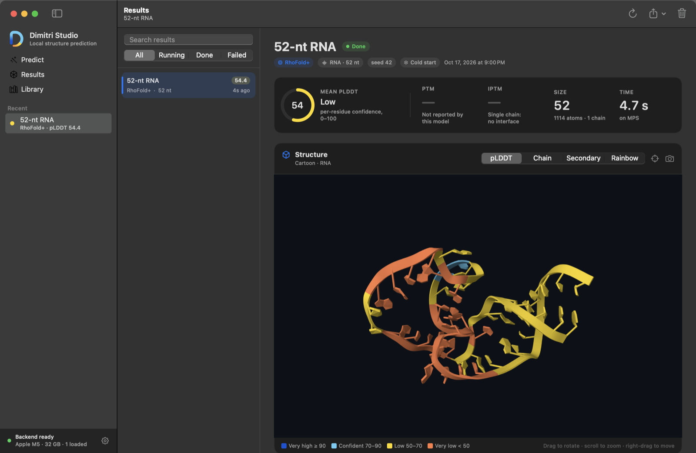

<p align="center">
  <picture>
    <source media="(prefers-color-scheme: dark)" srcset="docs/logo-dark.png">
    
  </picture>
</p>

<p align="center"><b>Protein and RNA structure prediction on your Mac.</b><br>
Pick a model, paste a sequence, watch it fold on the Apple GPU, then inspect, compare and export the structure.<br>
Your sequences and results never leave the Mac.</p>



## Install

You need a Mac with Apple Silicon (M1 or later) and macOS 14 or later.

1. Open **Dimitri-Studio-0.2.0.dmg** and drag **Dimitri Studio** to
   Applications. The disk image is built with `scripts/build-app.sh --dmg`
   ([Build from source](#build-from-source)); it is not published as a
   GitHub release yet, pending notarization.
2. Open it. The first launch sets up the app's Python environment by itself
   (about a minute, needs the internet once). No Terminal, Homebrew or Python
   install is needed: the app carries its own copy of [uv](https://docs.astral.sh/uv/).
3. The Welcome guide checks Apple's Command Line Tools (one click to install;
   models need git and a compiler), installs **RhoFold+** with one click
   (about 1.3 GB including PyTorch), and folds a sample RNA in seconds.

The app is signed with a Developer ID but **not yet notarized**, so the first
time macOS may say it cannot check it for malicious software. Control-click
the app, choose **Open**, then **Open** again. (See [Signing](#signing-and-notarization).)

## What it does

- **Predict**: paste a sequence or drop a FASTA file anywhere in the window.
  Protein, RNA, DNA or ligand is detected from the letters. Pick one model, or
  several to compare them on the same input. Built-in examples: the 52-nt RNA
  from PDB 6TB7 and the Trp-cage miniprotein (PDB 1L2Y).
- **Results**: live stages (RhoFold+ recycles, AlphaFold 3 trunk and diffusion
  steps), then a 3D cartoon coloured by confidence (pLDDT) with a band legend,
  per-residue pLDDT with hover read-outs, PAE heatmap, RNA secondary structure
  (dot-bracket), run details (device, warm or cold start, timings, GPU memory),
  and export to mmCIF, PDB, JSON or a PNG of the view. Drop a PDB or mmCIF file
  to open it as a result.
- **Compare**: results of the same sequence are superposed in one viewer, with
  RMSD, per-residue deviation and the models' pLDDT side by side. A prediction
  can be compared with an experimental structure you open.
- **Library**: install models, see what is loaded and what is on disk.
- Keyboard: ⌘1/⌘2/⌘3 screens, ⌘N new prediction, ⌘O open, ⌘↩ run, ⌘R run
  again, ⌘K compare, ⌘. cancel, ⌘⌫ delete, ⌘E/⌥⌘E/⇧⌘E export mmCIF/PDB/JSON,
  ⇧⌘S save image, ⌘, settings. Light and dark mode; VoiceOver labels; motion
  follows Reduce Motion.

## Models

| Model | Runtime | Device | Inputs | Confidence |
|---|---|---|---|---|
| **RhoFold+** | [rhofold-mac](https://github.com/vasanthsreeram/rhofold-mac) (PyTorch) | Apple GPU (MPS), CPU fallback | RNA | pLDDT, secondary structure |
| **AlphaFold 3** | [mac-af3](https://github.com/vasanthsreeram/mac-af3) on [alphafold3-mac](https://github.com/omrikais/alphafold3-mac) (MLX) | Apple GPU (MLX) | protein, RNA, DNA, ligand | pLDDT, pTM, ipTM, PAE |
| OpenFold3-MLX | [openfold-3-mlx](https://github.com/latent-spacecraft/openfold-3-mlx) | MPS | protein, RNA, DNA | pLDDT, pTM, ipTM |

### RhoFold+ (rhofold-mac)

Library → Install clones rhofold-mac and runs its own `./setup.sh` (pinned
PyTorch, upstream RhoFold at a fixed commit with rhofold-mac's speed patch,
public weights from Hugging Face checked by SHA-256) and `./doctor.sh`.
Nothing from it is copied into this repository; its experimental MLX path
stays off. Single-sequence mode, no Amber relaxation, as in rhofold-mac.

Dimitri keeps the model loaded in a worker process between jobs and writes the
same files as `./run.sh` (`unrelaxed_model.pdb`, `ss.ct`, `results.npz`,
`run_info.json`). It reports pLDDT on 0–100 and fixes one upstream quirk:
RhoFold's PDB writer stores each residue's confidence in the *next* residue's
B-factor, so Dimitri rewrites the B-factors from the model output.

### AlphaFold 3 (mac-af3)

AlphaFold 3 runs through **mac-af3**, Vas's runtime for frozen AlphaFold 3
weights on Apple Silicon: a compiled diffusion sampler, 64-token buckets,
weight streaming and memory patches that let it run on a 16 GB Mac, applied to
an unmodified alphafold3-mac checkout. Library → Install clones mac-af3 (a
private repository, so it uses your own GitHub access) and alphafold3-mac at
the commit mac-af3 pins (3d1ce7b), builds it, and prepares mac-af3's weight
shards.

**You must supply the AlphaFold 3 weights yourself.** They are not included,
Dimitri cannot download them, and nothing here redistributes them. mac-af3
runs on your own copy of the official parameters, `af3.bin.zst`, obtained from
Google DeepMind under the
[AlphaFold 3 model parameter terms](https://github.com/google-deepmind/alphafold3/blob/main/WEIGHTS_TERMS_OF_USE.md).
Put it in `~/.alphafold3/weights/model/` (or the folder set in Settings). Setup
checks it against mac-af3's pinned SHA-256
(`74d02586…1f33ff`) and builds a local streaming cache from it in
`~/.alphafold3/shards`, which also never leaves your Mac.

Dimitri runs AlphaFold 3 in **single-sequence mode**: no MSA search and no
templates, so nothing leaves the Mac. Results are less accurate than with an
MSA, especially for proteins, and each result says so.

### OpenFold3

Unchanged from phase 1. Its default runner enables the ColabFold MSA server,
so protein sequences are sent to that service; it is the one exception to
"nothing leaves the Mac".

## Performance

Measured on an Apple M5 MacBook Air (32 GB, macOS 26.6) on 2026-10-17, with
other apps open (load average about 4). Times are end to end through the job
API: queueing, the model, structure conversion and writing results.

**RhoFold+, 52-nt RNA (6TB7 chain A)** (`scripts/bench_runner.py`):

| | Per job |
|---|---|
| Before: a fresh rhofold-mac process per job (the phase 1 design) | 4.9–5.7 s, median 5.7 s (very first run 12.1 s) |
| After, first job: starts the warm worker and loads the model (2.1 s) | 4.4 s |
| After, next jobs: model already loaded | **2.2–2.5 s, median 2.4 s (2.4× faster)** |

The prediction itself stays about 2.1–2.5 s; the saving is Python start-up,
importing PyTorch and loading the weights. A loaded RhoFold+ worker holds
about 2.6 GB.

**AlphaFold 3, Trp-cage (20 residues), 2 samples × 20 diffusion steps**
(`scripts/bench_runner.py --model alphafold3-mac --jobs 1 --samples 2`):

| | Per job |
|---|---|
| Before: stock alphafold3-mac CLI, fresh process, its 256-token bucket (phase 1) | 257 s |
| mac-af3 runtime, fresh process per job | 37.9 s |
| mac-af3 warm worker, first job (worker start and 3.9 s model load) | 21.2 s |
| mac-af3 warm worker, next jobs | **13.6 s** (features 0.2, trunk 10.6, diffusion 2.6) |

Most of the AlphaFold 3 gain is mac-af3's 64-token buckets and compiled
sampler (trunk 216 s → 11 s); keeping the model and chemical dictionary loaded
takes a job from 37.9 s to 13.6 s. Mean pLDDT is unchanged (96.8–97.0). The
stock-CLI figure was measured while other model jobs were running.

Memory: each model process gets a budget of RAM minus max(4 GB, 20 %); MLX's
buffer cache is capped at 5 % of RAM; models unload after 5/15/30 minutes idle
(16/32/64 GB Macs), configurable in Settings.

## What works, and what does not (yet)

Verified on this Mac:

- The signed app starts and stops its own backend; first-launch environment
  setup with the bundled uv.
- RhoFold+ installed through rhofold-mac's setup and doctor; predictions
  through the app with warm workers; cold fallback through `run.sh`.
- AlphaFold 3 through mac-af3 and alphafold3-mac (setup script, weights
  checksum, shards, warm predictions on Trp-cage).
- The viewer: cartoons for protein (1L2Y, with its helix) and RNA (RhoFold+
  output in pLDDT bands), offline, checked by rendering
  (`scripts/viewer-check.sh`) and in the running app.
- Imports, superposition and comparison; exports; event stream; settings.
- 80+ backend tests; `swift build` without warnings.

Not done or not verified:

- **Notarization**: no notarytool keychain profile exists on this Mac, so the
  app is signed but not notarized ([below](#signing-and-notarization)).
- **MSAs and templates**: AlphaFold 3 and RhoFold+ run single-sequence only.
- **One chain per job**: no complexes, protein–ligand pairs, modifications or
  restraints yet.
- **OpenFold3** was not installed or run here; it keeps its phase 1 runner
  (one process per job, no warm worker).
- AlphaFold 3 on a 16 GB Mac (layer streaming) is configured from mac-af3's
  measurements but was not run on 16 GB hardware here.
- LM Studio is detected for status only. There is no chat or language-model
  feature, by design.
- bio.rodeo has no API; the catalogue reads its public pages
  ([notes](docs/BIO_RODEO.md)).

## Viewer: what was wrong

Structures showed as loose "circular dots". Every structure the phase 1 app had
displayed on this Mac came from its demo runner, and those PDB files were
malformed: atom names sat one column too far left, so `ALA` was read as
alternate location `A` plus residue `LA`, with no chain. Mol* found no polymer,
and the old page relied on Mol*'s automatic preset, which draws anything that
is not a polymer as unbonded atoms. The page also loaded Mol* from a CDN (no
network, no viewer) without its stylesheet, never coloured by confidence,
reloaded itself for every structure and had no way to report an error. The
mmCIF it was given came from Biopython, which writes no entity records and
splits a chain at modified residues (tRNA 1EHZ became 12 fragments).

Now Mol* 5.12.0 is bundled and works offline; the viewer receives each model's
own file in its own format (PDB or mmCIF); it builds the representations
itself (cartoon for protein and RNA, with computed secondary structure when the
file has none; ball-and-stick only for ligands) and never falls back to atoms
for a polymer; pLDDT uses the AlphaFold bands from the B-factors; files without
confidence values (experimental or NMR structures) are coloured by secondary
structure and the legend says so; a file with no recognisable polymer is
reported as such. Exports are written with gemmi, with entity records and whole
chains. Checked by rendering 1L2Y (cartoon with its α-helix) and RhoFold+
output (RNA cartoon in pLDDT bands) offscreen: `scripts/viewer-check.sh`.
The old phase 1 demo results in an existing `~/.dimitri` still show atoms,
because their files contain no polymer; delete them from Results.

## Build from source

```bash
git clone https://github.com/vasanthsreeram/Dimitri.git
cd Dimitri
./scripts/run.sh            # builds and opens the app; it starts the backend itself
```

Needs Xcode or the Command Line Tools (Swift 6) and [uv](https://docs.astral.sh/uv/).
`./scripts/run-backend.sh` runs only the backend on port 8642; the app uses
an already-running backend and leaves it running.

```bash
./scripts/test.sh                       # backend tests, swift build, viewer check
./scripts/build-app.sh --dmg            # signed dist/Dimitri Studio.app and .dmg
backend/.venv/bin/python scripts/bench_runner.py   # RhoFold+ cold vs warm timings
```

### Signing and notarization

`scripts/build-app.sh` signs with "Developer ID Application: Vasanth Sreeram
(UTSTY3J6NS)", hardened runtime, secure timestamp and an empty entitlements
file, then runs `codesign --verify --deep --strict` and `spctl`. Gatekeeper
reports "Unnotarized Developer ID" until Apple notarizes the app. To notarize:

```bash
xcrun notarytool store-credentials dimitri-notary \
  --apple-id <your Apple ID> --team-id UTSTY3J6NS \
  --password <app-specific password from appleid.apple.com>
scripts/notarize.sh                     # notarize and staple the app
scripts/make-dmg.sh --notarize-profile dimitri-notary
```

## Layout

```
app/                    SwiftUI app (SwiftPM); Bundle/ holds Info.plist, entitlements, icon
  Sources/DimitriStudio/Resources/Viewer/   bundled Mol* and Dimitri's viewer page
backend/                FastAPI backend (uv)
  dimitri/runners/      runners, setup scripts, warm workers (workers/)
  tests/                pytest suite
design/                 logo and icon sources (SVG)
docs/                   bio.rodeo notes, screenshots, logos
scripts/                run, test, build-app, notarize, make-dmg, icons, viewer check, bench
```

## Privacy

Sequences and structures stay under `~/.dimitri` and go only to the local
backend on 127.0.0.1. Model setup downloads code and public weights from
GitHub and Hugging Face; the catalogue refresh reads bio.rodeo. OpenFold3's
default MSA server is the one exception noted above. No analytics.

## Credits

- AlphaFold 3: Abramson et al., *Nature* 630, 493–500 (2024). Runtime:
  mac-af3 (Vasanth Sreeram) on [alphafold3-mac](https://github.com/omrikais/alphafold3-mac)
  (CC-BY-NC-SA 4.0). Weights under DeepMind's terms, never distributed here.
- RhoFold+: Shen et al., *Nature Methods* 21, 2287–2298 (2024),
  [ml4bio/RhoFold](https://github.com/ml4bio/RhoFold) (Apache-2.0), run through
  [rhofold-mac](https://github.com/vasanthsreeram/rhofold-mac) (Apache-2.0).
- OpenFold3: AlQuraishi Lab, [openfold-3-mlx](https://github.com/latent-spacecraft/openfold-3-mlx) (Apache-2.0).
- [Mol*](https://molstar.org) (MIT), [gemmi](https://gemmi.readthedocs.io) (MPL 2.0),
  [uv](https://github.com/astral-sh/uv) (MIT/Apache-2.0, bundled in the app).
- Catalogue metadata: [bio.rodeo](https://bio.rodeo), not affiliated.
