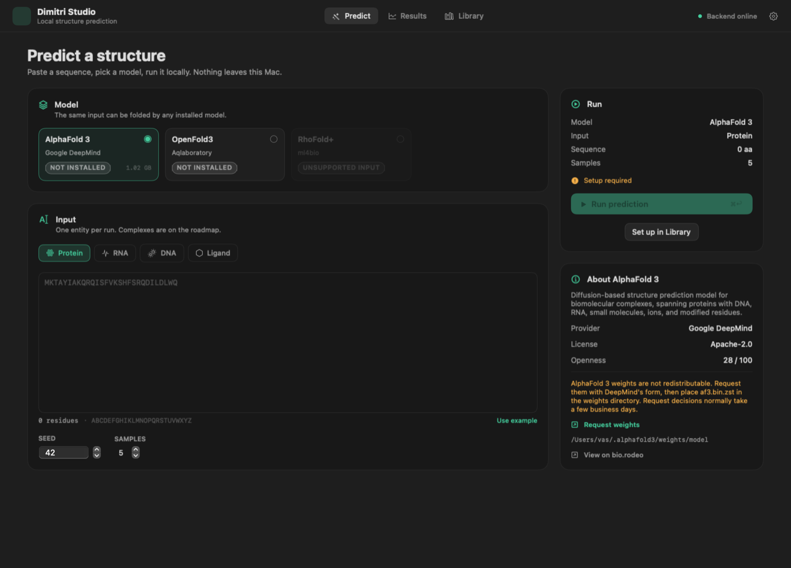

# Dimitri Studio

A simple, local-first Mac app for running protein and RNA structure models. Pick a
model, paste a sequence, watch the stages, then inspect and export the structure.
AlphaFold 3 and RhoFold stay on the Mac; OpenFold3's default runner enables its
ColabFold MSA server, which is the one exception.

This is an early build. It runs, it builds, and the pipeline is tested end to end
with a synthetic runner. The three real models are integrated against their
documented interfaces but have not been exercised on this machine because their
weights and multi-gigabyte environments are not present.

| Area | State |
|---|---|
| SwiftUI app: Predict, Results, Library, Settings | Working; `swift build` passes |
| Backend: job queue, live stages (SSE), storage, exports | Working; 59 pytest tests pass |
| CIF, PDB and JSON export | Working and tested |
| Mol* 3D viewer | Loads from jsDelivr; verified headlessly. Needs network |
| bio.rodeo catalogue | Working adapter against live pages; no public API (see below) |
| LM Studio detection (`localhost:1234/v1`) | Working, status only |
| AlphaFold 3 runner (`alphafold3-mac`) | Implemented against the upstream CLI; not run (checkout absent; weights are present on this machine) |
| RhoFold+ runner (PyTorch MPS) | Implemented; setup script and vendored patch present; checkpoint not downloaded |
| OpenFold3 runner (`openfold-3-mlx`) | Implemented against the upstream CLI; environment not installed |
| Synthetic demo runner | Working; hidden from users, used by tests |



## Platform and runtime

Dimitri Studio is **MacBook-only**: Apple Silicon (M1 or later), macOS 14+, Metal
through MLX or PyTorch MPS. There is no CUDA path, no llama.cpp, and no GGUF.
Each Python model runtime lives in its own environment; the Swift app never loads
weights or runs inference itself.

| Model | Runtime | Device | Fallback |
|---|---|---|---|
| AlphaFold 3 | `alphafold3-mac` MLX port | `mlx` (Metal) | none |
| RhoFold+ | PyTorch (upstream RhoFold+) | `mps` | CPU, last resort |
| OpenFold3-MLX | MLX kernels on PyTorch (`mlx_runner.yml`) | `mps` | none |

MLX is preferred wherever a port exists. PyTorch MPS is the fallback for models
without an MLX port. CPU is only used when MPS is unavailable; the result's
**Device** row and note say when that happened.

DeepSeek and other language models are not inference engines for these structure
models, so none is used. LM Studio is detected for status only; there are no LLM
features.

## Requirements

- MacBook with Apple Silicon (M1 or later), macOS 14 or later
- Xcode Command Line Tools (Swift 6)
- [uv](https://docs.astral.sh/uv/) for the Python backend
- Network access to install models, refresh the catalogue, and load Mol*

Model sizes and memory differ a lot. Upstream guidance:

| Model | Weights | Other disk | Notes |
|---|---|---|---|
| AlphaFold 3 MLX | ~1 GB (`af3.bin.zst`) | ~3 GB checkout/deps | Upstream recommends a Max/Ultra chip and 36 GB+ unified memory; weights under DeepMind's terms |
| RhoFold+ | ~508 MB checkpoint | small | Runs on MPS; RNA only |
| OpenFold3-MLX | several GB | ~10 GB with dependencies | Upstream targets 16 GB+ |

## Install and run

```bash
git clone https://github.com/vasanthsreeram/Dimitri.git
cd Dimitri
./scripts/run.sh
```

`scripts/run.sh` starts the backend on `http://127.0.0.1:8642`, waits for it to be
healthy, then launches the app with `swift run`. Stopping the app also stops the
backend it started.

Two-terminal alternative:

```bash
./scripts/run-backend.sh     # terminal 1
./scripts/run-app.sh         # terminal 2
```

First launch creates `~/.dimitri/` with `models/`, `results/` and `cache/`.
Use the gear button to change those paths.

## Using it

1. Open **Library** and install a model. Each card says whether the runner is
   installed and whether its weights were found.
2. Open **Predict**, pick the model, choose an entity type, paste a sequence, set
   seed and sample count, and press **Run prediction**.
3. **Results** shows live stages, then pTM, ipTM, mean pLDDT, a per-residue pLDDT
   chart, a PAE heatmap and the Mol* viewer. Export CIF, PDB or JSON with a save
   panel.

Inputs are one entity per job. Complexes, ligand + protein jobs and restraints are
not implemented yet.

### AlphaFold 3 weights

Dimitri never downloads AlphaFold 3 weights. DeepMind's old request form is now
closed; it currently publishes the parameters directly:

<https://storage.googleapis.com/alphafold3/af3.bin.zst>

They are governed by the
[AlphaFold 3 Model Parameters Terms of Use](https://github.com/google-deepmind/alphafold3/blob/main/WEIGHTS_TERMS_OF_USE.md).
Place the file in the weights directory shown in the Library and Settings (default
`~/.alphafold3/weights/model/`). The runner recognises `af3.bin.zst`, `af3.bin`,
`af3.*.bin.zst` and split `af3.bin.zst.*` shards.

Library → Install clones `omrikais/alphafold3-mac` into
`~/.dimitri/models/alphafold3-mac` and runs `uv sync`. If the CLI still reports
missing native tooling, run its interactive `./scripts/install.sh` in that checkout.

### RhoFold+

Library → Install clones `ml4bio/RhoFold`, applies Dimitri's vendored,
algebraically equivalent MPS speed patch (`RHOFOLD_FAST=1`), creates a Python
environment with uv, and downloads the public `cuhkaih/rhofold` checkpoint from
Hugging Face. Attribution and the patch hash are in
`backend/dimitri/runners/vendor/rhofold/ATTRIBUTION.md`.

The runner uses single-sequence mode (the FASTA also serves as the MSA) and no
Amber relaxation. RhoFold reports pLDDT only; pTM, ipTM and PAE are shown as not
reported.

### OpenFold3

Library → Install clones `latent-spacecraft/openfold-3-mlx`, installs it into a uv
environment, and downloads parameters into `~/.openfold3` (or the path in
Settings). The upstream `mlx_runner.yml` enables MSA and template search, so those
runs use the network.

## What works, and what is stubbed

Working and exercised here:

- End-to-end job pipeline with a synthetic runner: validation, stages, SSE, job
  persistence, restart recovery, cancellation of queued work, exports.
- All three screens plus the settings sheet; `swift build` passes; screens were
  rendered offscreen and inspected, and the running app polls the backend.
- Mol* loading in an offscreen WKWebView: CDN script loaded, CIF parsed, canvas
  created.
- bio.rodeo discovery and parsing (see `docs/BIO_RODEO.md`).
- CIF ↔ PDB conversion via Biopython; normalized confidence JSON.
- LM Studio `/v1/models` probe with a short timeout.

Not exercised here, and therefore not claimed as working:

- A real AlphaFold 3, RhoFold+ or OpenFold3 prediction. Their environments and
  weights are not installed in this checkout. The command lines, input JSON and
  output parsers follow each project's published documentation and are covered by
  unit tests where possible.
- Model install jobs that download gigabytes of weights in this build. The setup
  scripts and progress plumbing exist; only the demo runner was run.
- The RhoFold patch is vendored from a verified reference project but was not
  applied in this workspace (the reference is read-only).
- Playback of very large PAE matrices in the viewer; the heatmap downsamples to
  about 140 cells per axis.

Known limitations:

- Single entity per job; no complexes, ions, modifications or restraints.
- One worker, one job at a time. This protects unified memory.
- No database; jobs are JSON directories under `~/.dimitri/results/jobs/`.
- The app is a SwiftPM executable, not a signed/notarized `.app` bundle.
- Mol* comes from a CDN, so the 3D tab needs a network connection. Export still
  works offline.
- The JSON export is Dimitri's normalized confidence file, not each model's full
  raw output tree.
- PDB conversion through Biopython may lose non-standard chemistry from a CIF.
- bio.rodeo has no API; parsing can break when its page markup changes.

## Tests

```bash
./scripts/test.sh
```

or separately:

```bash
cd backend && uv sync --extra dev && .venv/bin/python -m pytest -q
cd app && swift build
```

## Layout

```
app/                     SwiftUI executable (Swift Package)
backend/                 FastAPI service, uv-managed
  dimitri/runners/       plugin interface, registry, three runners, setup scripts
  dimitri/catalog/       local catalogue + shipped bio.rodeo snapshot
  tests/                 pytest suite
docs/                    architecture, bio.rodeo notes, UI reference, screenshots
scripts/                 run.sh (one command), run-backend.sh, run-app.sh, test.sh
```

See [ARCHITECTURE.md](ARCHITECTURE.md) for the component and job-flow details, and
[docs/BIO_RODEO.md](docs/BIO_RODEO.md) for the catalogue evidence and its limits.

## Privacy

Sequences and structures are stored only on this Mac under `~/.dimitri` and are
sent to the local backend on `127.0.0.1`. Model setup and catalogue refresh make
outbound requests to GitHub, Hugging Face, OpenFold and bio.rodeo. OpenFold3's
default `mlx_runner.yml` enables the ColabFold MSA server, so protein sequences
are sent to that service unless MSA search is disabled upstream. No analytics.

## Attribution

- AlphaFold 3: Abramson et al., *Nature* 630, 493–500 (2024); MLX port by
  [omrikais/alphafold3-mac](https://github.com/omrikais/alphafold3-mac),
  CC-BY-NC-SA 4.0 code, model parameters under DeepMind's terms.
- RhoFold+: Shen et al., *Nature Methods* 21, 2287–2299 (2024);
  [ml4bio/RhoFold](https://github.com/ml4bio/RhoFold), Apache-2.0.
- OpenFold3: AlQuraishi Lab; [latent-spacecraft/openfold-3-mlx](https://github.com/latent-spacecraft/openfold-3-mlx), Apache-2.0.
- Catalogue metadata: [bio.rodeo](https://bio.rodeo), used as a public reference;
  Dimitri is not affiliated with it.
- Mol*: [molstar.org](https://molstar.org), MIT.
